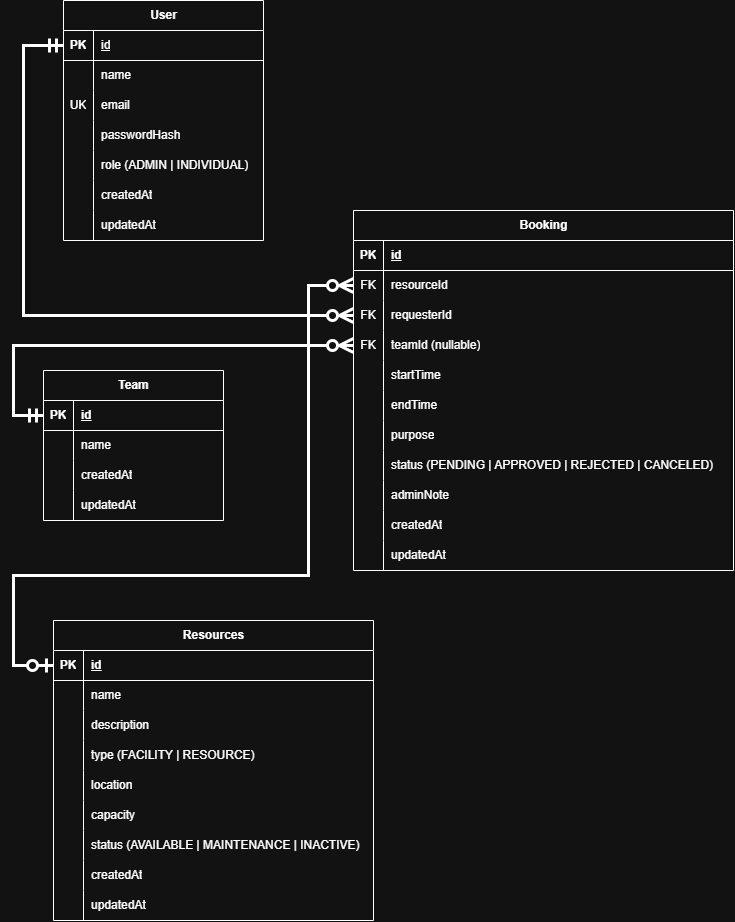

# Reservify – Resource Reservation Management System

A full-stack resource reservation management web application built with **Next.js 16 (App Router)**, **Prisma v7**, and **PostgreSQL on Neon Serverless**, secured with custom **httpOnly cookie sessions** and **role-based access control**.

## 🔗 Live Demo

- **Production URL:** [https://resource-reservation-management.vercel.app/](https://resource-reservation-management.vercel.app/)

---

## 🌟 Overview

Organizations often struggle to manage shared facilities and equipment through informal communication, spreadsheets, and manual tracking. This leads to booking conflicts, poor visibility into availability, and weak approval traceability.

**Reservify** solves this by providing a centralized system for managing shared resources, coordinating reservations, and tracking their lifecycle in a reliable way.

### Core capabilities

- **Role-based access** for administrators and individual users.
- **Conflict prevention** to block overlapping bookings for the same resource.
- **Approval workflow** with reservation lifecycle tracking and admin notes.
- **Availability visibility** through resource listings and booking views.
- **Scalable architecture** suitable for growing day-to-day operational activity.

---

## 🛠 Tech Stack

- **Framework:** Next.js 16 (App Router, Server Actions, Server Components)
- **Language:** TypeScript 5
- **ORM:** Prisma v7 (`@prisma/client`, `@prisma/adapter-pg`)
- **Database:** PostgreSQL on Neon Serverless
- **Authentication:** Custom session-based authentication with `bcryptjs` and secure cookies
- **Styling:** Tailwind CSS v4

---

## 📊 Database Design



The system is built around four main entities:

- **User** – stores login credentials and role permissions.
- **Team** – groups users and related reservations.
- **Resource** – represents facilities and shared equipment.
- **Booking** – connects the requester, resource, optional team, time window, and reservation status.

---

## 🚀 Getting Started

### 1. Prerequisites

Make sure you have the following installed:

- Node.js `v20.x` or higher
- npm, pnpm, or yarn
- A PostgreSQL database instance, such as [Neon](https://neon.tech)

### 2. Clone the repository

```bash
git clone <your-repository-url>
cd resource-reservation-management
```

### 3. Install dependencies

```bash
npm install
```

### 4. Configure environment variables

Create a `.env` file in the project root:

```env
# Runtime application connection (Neon pooled endpoint)
DATABASE_URL="postgresql://<user>:<password>@<ep-pooler-id>.neon.tech/neondb?sslmode=require"

# Prisma CLI / migration / seed connection (Neon direct endpoint)
DIRECT_URL="postgresql://<user>:<password>@<ep-direct-id>.neon.tech/neondb?sslmode=require&connect_timeout=30"
```

> **Note:** `DATABASE_URL` is used by the running application, while `DIRECT_URL` is used for Prisma CLI tasks such as schema sync and seeding. Relative to Neon’s setup guidance, pooled connections are preferred for runtime and direct connections are preferred for migrations and seed operations. [web:888]

### 5. Generate Prisma Client

```bash
npx prisma generate
```

### 6. Synchronize the database schema

```bash
npx prisma db push
```

### 7. Seed demo data

```bash
npx prisma db seed
```

### 8. Run the development server

```bash
npm run dev
```

Then open:

```text
http://localhost:3000
```

---

## 🔑 Demo Credentials

| Role | Email | Password | Access |
|---|---|---|---|
| **System Admin** | `admin@reservify.local` | `Admin123!` | Review bookings, approve/reject requests, manage resources, view full calendar |
| **Individual User** | `kavindu@reservify.local` | `User123!` | Request bookings, explore resources, cancel own pending bookings |
| **Individual User** | `kavishka@reservify.local` | `User123!` | Request bookings and view personal reservation history |

---

## 📐 Key Engineering Decisions

### 1. Prisma v7 + Neon connection model

Prisma v7 uses driver adapters for direct database access, so the application is designed with a serverless-aware connection approach. The runtime application uses a pooled PostgreSQL connection, while Prisma CLI tasks use a direct connection.

### 2. Conflict prevention engine

Before creating a booking, the system checks for overlapping reservations on the same resource using the time-window rule below:

```text
existing.startTime < requestedEnd AND existing.endTime > requestedStart
```

This prevents double-booking and preserves reservation integrity.

### 3. Custom session authentication

Authentication is implemented using hashed passwords with `bcryptjs` and secure `httpOnly` cookies. This keeps session tokens inaccessible to client-side JavaScript and supports role-based authorization without external auth providers.

### 4. Server Actions for mutations

Booking creation, approval decisions, authentication actions, and resource updates are handled through Next.js Server Actions. This keeps business logic on the server and reduces client-side inconsistency.

---

## 🧩 Functional Requirements Covered

- User login and logout
- Role-based access for admin and individual users
- View available resources
- Create a booking request
- Associate a booking with a team
- Prevent overlapping reservations
- Approve or reject booking requests
- Cancel pending bookings
- Manage resource inventory
- Track reservation status and notes

---

## ⚙️ Non-Functional Requirements Covered

- Secure session handling with `httpOnly` cookies
- Password hashing with `bcryptjs`
- Data integrity through server-side validation
- Reliable connection strategy for serverless deployment
- Responsive user interface for practical daily use

---

## 🧪 Suggested Local Test Flow

1. Sign in as a normal user.
2. Create a booking request for a resource and team.
3. Try creating another booking for the same resource at an overlapping time.
4. Verify the conflict is rejected.
5. Log in as admin.
6. Review the pending booking.
7. Approve or reject it with an admin note.
8. Verify the updated booking status in the system.

---

## 📁 Project Structure

```text
resource-reservation-management/
├── assets/
│   └── reservify-er-diagram.png
├── prisma/
│   ├── schema.prisma
│   └── seed.ts
├── src/
│   ├── app/
│   ├── components/
│   ├── lib/
│   └── actions/
├── public/
├── README.md
├── package.json
└── .env
```

---

## 🔮 Future Improvements

- Recurring reservations
- Email or Slack notifications
- QR-based room check-in
- Advanced utilization analytics
- Search and filtering for large resource inventories

---

## 👤 Author

Developed as part of a software engineering technical assessment project.
