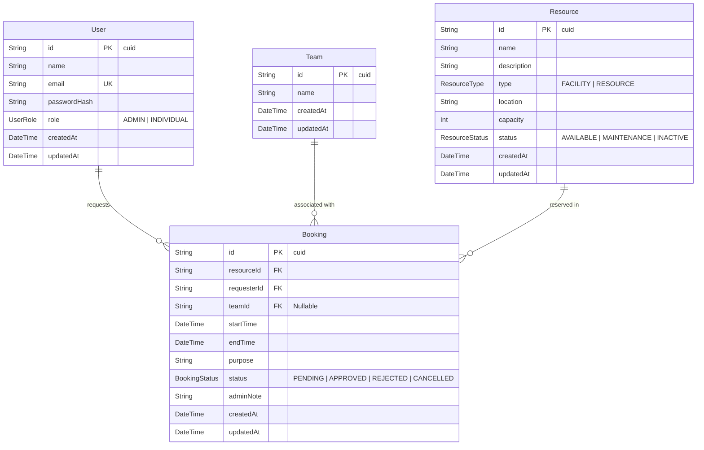

# Reservify – Resource Reservation Management System

A high-performance, full-stack Resource Reservation Management web application built with **Next.js 16 (App Router)**, **Prisma v7**, and **PostgreSQL on Neon Serverless**, secured by custom httpOnly cookie sessions and role-based access control.

---

## 🌟 Overview & Business Problem Solved

Organizations frequently struggle with resource contention, double-booking, and inefficient approval workflows for shared physical spaces (meeting rooms, training labs) and specialized equipment (projectors, audio/visual kits). 

**Reservify** resolves these challenges by providing:
- **Role-based Workspaces:** Differentiated views and capabilities for System Admins and Individual Requesters.
- **Overlap & Conflict Prevention:** Strict time-window conflict detection preventing overlapping bookings on the same resource.
- **Auditable Approvals:** Lifecycle tracking (`PENDING` → `APPROVED` / `REJECTED` / `CANCELLED`) with administrative notes.
- **Real-Time Availability & Calendars:** Unified calendar and resource inventory tracking with visual status indicators.

---

## 🛠 Tech Stack & Architecture

- **Framework:** Next.js 16 (App Router, Server Actions, Server Components)
- **Language:** TypeScript 5
- **ORM:** Prisma v7 (`@prisma/client`, `@prisma/adapter-pg`)
- **Database:** PostgreSQL on Neon Serverless (PgBouncer connection pooling for runtime + direct connection for CLI)
- **Authentication:** Custom session-based authentication using `bcryptjs` and `httpOnly`, `SameSite=Lax`, `Secure` cookies (no third-party Auth bloat)
- **Styling:** Tailwind CSS v4

---

## 📊 Database Design (Entity-Relationship)



---

## 🚀 Getting Started

### 1. Prerequisites
- Node.js `v20.x` or higher
- npm, pnpm, or yarn
- A PostgreSQL database instance (such as [Neon.tech](https://neon.tech))

### 2. Environment Variables Setup
Create a `.env` file in the root directory:

```env
# Runtime App Connection (Neon Pooled endpoint via PgBouncer)
DATABASE_URL="postgresql://<user>:<password>@<ep-pooler-id>.neon.tech/neondb?sslmode=require"

# Prisma CLI & Seed Connection (Neon Direct unpooled endpoint)
DIRECT_URL="postgresql://<user>:<password>@<ep-direct-id>.neon.tech/neondb?sslmode=require&connect_timeout=30"
```

> **Note on Neon Configuration:** Do not append `&channel_binding=require` as it is incompatible with connection poolers and Prisma CLI engines. `connect_timeout=30` accommodates Neon cold-start compute spin-up.

### 3. Installation & Database Setup
Install dependencies:
```bash
npm install
```

Generate Prisma Client:
```bash
npx prisma generate
```

Synchronize the database schema with Neon:
```bash
npx prisma db push
```

Seed initial demo data (users, resources, teams, demo bookings):
```bash
npx prisma db seed
```

### 4. Run the Development Server
```bash
npm run dev
```

Navigate to [http://localhost:3000](http://localhost:3000) in your browser.

---

## 🔑 Demo Credentials

| Role | Email | Password | Access Capabilities |
| :--- | :--- | :--- | :--- |
| **System Admin** | `admin@reservify.local` | `Admin123!` | Dashboard, review/approve/reject bookings, resource inventory CRUD, full reservation calendar |
| **Individual User** | `kavindu@reservify.local` | `User123!` | Personal dashboard, explore resources, request bookings, cancel own pending bookings |
| **Individual User** | `kavishka@reservify.local` | `User123!` | Request bookings, view personal reservation history |

---

## 📐 Key Engineering Decisions

1. **Prisma v7 Driver Adapters with Neon Connection Pooling:**
   Instead of instantiating ephemeral connection pools on every serverless invocation, `src/lib/prisma.ts` creates a global persistent `pg.Pool` instance configured specifically for serverless environments (`max: 10`, `connectionTimeoutMillis: 10000`, `idleTimeoutMillis: 30000`).
2. **Conflict Prevention Engine:**
   Before inserting any reservation, `createBooking` executes atomic overlap verification using date comparisons (`startTime < requestedEnd AND endTime > requestedStart`) for all non-rejected bookings.
3. **Resilient Session Cookie Management:**
   Session tokens are transported via `httpOnly`, `SameSite=Lax`, and `Secure` (in production) cookies, guarding against XSS attacks while remaining resilient to URL decoding and proxy environments.
4. **App Router Server Actions:**
   Mutations are executed exclusively via Next.js Server Actions with immediate cache revalidation (`revalidatePath`), minimizing client-side state inconsistency.
